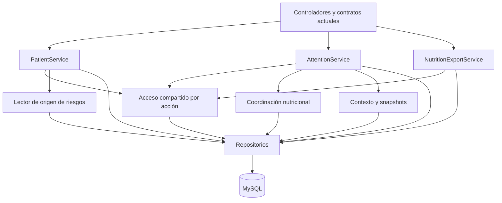

# Plan para separar responsabilidades del backend conservando el flujo actual

Fecha: 20/10/2026. Estado: implementación realizada; ver [cambios, pruebas y resultados](REFACTOR_BACKEND_RESULTADOS_20261020.md). Las fases siguientes conservan el diseño acordado como referencia.

## 1. Objetivo y alcance

Reorganizar pacientes, atenciones y exportación nutricional para que una modificación de permisos, validaciones, nutrición o documentos tenga un lugar claro. Las pantallas, operaciones HTTP y resultados de negocio seguirán siendo los actuales.

El trabajo conserva FastAPI, SQLAlchemy, MySQL, la arquitectura por capas y los servicios públicos existentes. Los módulos nuevos serán colaboradores concretos de esos servicios. Cada extracción debe reducir una dependencia o separar un motivo real de cambio; reducir líneas por sí solo no es un objetivo.

Puntos de partida comprobados en el código:

| Área actual | Concentración o dependencia que se busca resolver |
| --- | --- |
| `app/services/patient.py` | 1 165 líneas; `PatientService` tiene 42 métodos sobre identidad, residencia, seguros, responsables, riesgos, acceso y auditoría. |
| `app/services/attention.py` | 780 líneas; `create` ocupa 170 y combina contexto, validación, nutrición, snapshots y persistencia. |
| `app/services/nutrition_export.py` | Hereda de `AttentionService` y usa sus repositorios y comprobaciones privadas. |
| `PatientService._risk_origin` | Instancia `AttentionService` para leer una atención completa aunque necesita su origen y valoración. |
| Autorización | La identidad y el ámbito clínico se resuelven en varios servicios y repositorios. Ya se corrigió la divergencia de ADMIN + PROFESIONAL; hay que conservarla corregida. |

El catálogo de unos veinte consultorios queda fuera de esta refactorización, de acuerdo con el alcance comentado. Las optimizaciones de índices, cambios de esquema, idempotencia HTTP nueva y revisión general del formato del repositorio serán trabajos separados.

## 2. Contrato de comportamiento que debe conservarse

Esta tabla sirve como criterio de aceptación, no solo como documentación.

| Paso del trabajo actual | Comportamiento que debe permanecer |
| --- | --- |
| Seleccionar o registrar paciente | Las búsquedas conservan su ámbito de acceso. El alta mantiene validaciones, responsables y riesgos iniciales, con auditoría dentro del mismo guardado. |
| Editar datos en admisión | Se conserva el borrador; **Guardar cambios** realiza el PATCH de datos maestros. Un campo omitido no se borra; un null permitido sí conserva su significado. |
| Guardar responsable o riesgo | Mantienen sus endpoints y reglas propios. No se reemplazan las colecciones desde el PATCH maestro. |
| Guardar atención | El POST registra un acto nuevo. No vuelve a guardar el borrador del paciente ni se convierte en una operación que incluya el PATCH anterior. |
| Fallar una atención después de un PATCH exitoso | El PATCH ya confirmado permanece. La atención fallida no deja sus propios registros parciales. |
| Vista previa nutricional | Sigue siendo una lectura sin escritura ni auditoría de cambio. El servidor vuelve a calcular al registrar. |
| Registrar nutrición | Se conservan fórmulas, rangos, precisión Decimal, grupos, fechas y tratamiento de cero, false y null. |
| Antecedentes de crecimiento | La referencia previa sigue respetando fecha, estado y ámbito. Se consulta en el backend; no se deduce de las cinco filas visibles en la pantalla. |
| Referencia de ingreso | Sigue admitiendo atención sin profesional/consultorio cuando el contrato lo permite. Conserva datos de origen, números con ceros iniciales y reglas de modalidad. |
| Historial | Últimas cinco por defecto; **Traer todas**, **Ver últimas 5** y **Refrescar** conservan su funcionamiento. La ficha mantiene páginas de cinco. |
| Documentos e impresión | FUA, certificados y referencias conservan formatos, numeración, autorizaciones y datos históricos. |
| Exportación nutricional | Sigue siendo un archivo de revisión y confirmación manual; no se incorpora una integración externa con SIS/SIEN. |
| Anulación y bajas | Se mantienen lógicas, con sus motivos y restricciones. Las atenciones con documentos vigentes mantienen la restricción actual. |

También se conservan rutas, nombres de campos, códigos HTTP, códigos de error y mensajes usados por las pantallas. Cuando dos datos inválidos compitan, se preservará la precedencia observable de validaciones salvo que un cambio funcional se acuerde por separado.

## 3. Límites transaccionales que deben conservarse

Hay dos guardados independientes en admisión:

```text
Guardar cambios del paciente
  -> validar PATCH -> cambiar datos maestros -> auditar -> COMMIT A

Guardar atención
  -> validar contexto -> crear atención y detalles -> valoración y snapshots
  -> actualizar condición cuando corresponda -> auditar -> COMMIT B
```

COMMIT B no debe incluir COMMIT A. Dentro de B sí deben mantenerse juntos la atención, sus prestaciones, diagnósticos, evaluación nutricional, actualización de condición y auditorías correspondientes.

Reglas de implementación:

1. El método público que representa la operación completa conserva commit/rollback.
2. Los colaboradores validan, calculan, leen o preparan cambios en la misma sesión; no hacen commit ni abren otra sesión para completar esa operación.
3. Se conservan los bloqueos de fila y su orden. En atención, el bloqueo del paciente continúa protegiendo las operaciones que hoy dependen de él. Emisión/anulación continúan coordinándose mediante el bloqueo de atención.
4. Se mantiene el momento necesario de los flush: no auditar una entidad sin su ID ni guardar hijos sin el padre persistido en la transacción.
5. No sustituir mecánicamente los bloques actuales por `session.begin()`: la autenticación ya puede haber iniciado una transacción en esa sesión mediante una lectura. La primera versión conservará la gestión vigente.
6. Cambiar la respuesta posterior al commit o introducir claves de idempotencia requiere una entrega funcional aparte. Esta refactorización no debe presentarse como solución a esos otros hallazgos.

## 4. Organización propuesta

Los siguientes nombres son propuestas de módulos; todavía no existen todos. Se crearán únicamente cuando la fase los necesite.

| Pieza | Responsabilidad y límite |
| --- | --- |
| `PatientService` | Conserva su API pública y coordina altas, PATCH, bajas y operaciones de relaciones. Sigue siendo el dueño de sus transacciones. |
| `AttentionService` | Conserva `create`, `get`, historial, vista previa y anulación. Coordina colaboradores con reglas y resultados explícitos. |
| `ClinicalAccessService` en `app/services/clinical_access.py` | Resuelve el contexto del actor y aplica las políticas de acceso correspondientes a cada acción. No confirma escrituras. |
| Consultas compartidas de acceso en repositorio | Obtienen profesional activo, asignaciones y vínculos. Se reutilizan sin copiar la misma consulta en cada agregado. |
| Contexto clínico de trabajo en `app/services/attention_context.py` | Carga los datos requeridos para la operación y transporta un contexto interno tipado. Distingue datos actuales de los históricos ya guardados. |
| Coordinación nutricional en `app/services/nutrition_assessment.py` | Reutiliza `app/domain/nutrition.py`, `nutrition_followup.py` y las reglas existentes para vista previa y registro. No modifica las fórmulas ni guarda por cuenta propia. |
| Funciones de snapshots existentes | `nutrition_context` y `build_fua_snapshot` conservan su formato. Reciben datos preparados; la carga de relaciones se hace explícita fuera de los constructores de snapshots. |
| Lector de origen en `app/services/attention_origin.py` | Devuelve los datos mínimos autorizados que necesita el seguimiento de riesgos. No depende del servicio que crea o cancela atenciones. |
| Colaboradores de pacientes | Validación de datos maestros, responsables y riesgos se separan en unidades cohesivas. Las reglas puras siguen en `app/domain`; las comprobaciones que consultan catálogos permanecen en la capa de aplicación. |
| `NutritionExportService` | Clase independiente, compuesta con repositorio, política de acceso y mapper de exportación. Conserva sus transacciones. |
| Proyección de exportación en mapper | Prepara el contrato de revisión y legado con la misma serialización y precisión. No usa herencia para acceder a una atención. |

Los nombres e imports públicos actuales se conservarán durante la transición. Por ejemplo, el controlador seguirá importando `AttentionService` desde el mismo módulo. Se pueden añadir dependencias opcionales por palabra clave para facilitar pruebas, manteniendo los constructores existentes.



La exportación y el lector de origen dejan de depender de la clase completa `AttentionService`.

## 5. Ejecución por fases

Cada fase es una entrega revisable. Se integrará la siguiente cuando la anterior conserve los contratos y pase sus verificaciones.

### Fase 0. Fijar la referencia del comportamiento actual

**Trabajo:** inventariar rutas y consumidores; registrar firmas públicas, errores relevantes, auditorías y forma de los JSON históricos. Conservar todos los cambios locales existentes y separar las entregas para poder revertir una fase de forma aislada.

Reutilizar las pruebas actuales y completar únicamente huecos relevantes: permisos combinados, exportación, origen de riesgos y rollback de una atención con hijos. Los ejemplos de referencia usarán datos de pruebas controlados. Solo se normalizarán IDs y tiempos generados; no se normalizarán campos cuya diferencia pueda ocultar una regresión.

**Verificación:** obtener una ejecución actual de unitarias, integración MySQL desechable y cobertura completa. En esta conversación la última suite unitaria del backend pasó con 485 casos, y las últimas pruebas seleccionadas del frontend con 40; son antecedentes, no un nuevo resultado ni evidencia de integración MySQL.

**Salida:** matriz de contratos y conjunto de regresión reproducible. Si un fallo ya existe, registrarlo como previo y no atribuirlo a la extracción posterior.

### Fase 1. Separar la preparación del contexto y los snapshots

**Trabajo:** extraer de `AttentionService.create` la carga repetida de establecimiento, consultorio, profesional, especialidad y relaciones que consumen `nutrition_context` y `build_fua_snapshot`. Usar un contexto interno tipado con los datos necesarios.

Conservar las funciones existentes y sus adaptadores mientras se migran los llamados. Separar la obtención de datos de la generación de JSON: el constructor del snapshot no debe provocar consultas ocultas al recorrer una relación ORM que faltó cargar. La carga puede usar ORM en la capa de aplicación; la proyección final recibe datos explícitos.

**Se conserva:** estructura y versión de snapshots, datos SIS, origen de referencia, fechas y zonas horarias, precisión, campos opcionales y valores por defecto. No se reconstruyen atenciones antiguas a partir del paciente o catálogo actual.

**Verificación:** comparar los JSON de contexto y FUA antes/después para grupos y modalidades existentes; cambiar después el paciente y el catálogo y comprobar que las atenciones anteriores no cambian. Medir las consultas de preparación para detectar una regresión de carga.

**Salida:** `create` delega la preparación y construcción de snapshots sin cambiar el contenido guardado. Riesgo principal: relaciones faltantes o diferencias de serialización.

### Fase 2. Compartir la identidad y las políticas de acceso

**Trabajo:** introducir `ClinicalAccessService` y centralizar las consultas repetidas de identidad y asignaciones. Migrar por consumidor: lectura individual, búsqueda, escritura clínica y finalmente documentos/exportación.

Compartir la identidad no significa conceder los mismos derechos a todas las operaciones. Conservar estas diferencias:

| Acción | Regla que debe mantenerse |
| --- | --- |
| Pacientes | ADMIN conserva el alcance administrativo actual; PROFESIONAL mantiene sede, registro propio y relación asistencial según la consulta existente. |
| Lectura clínica | Exige identidad clínica válida y ámbito. ADMIN + PROFESIONAL con vínculo válido sigue aceptado; ADMIN solo sigue restringido. |
| Registro de atención | El actor autenticado y el profesional seleccionado son datos diferentes. Conservar las validaciones actuales que permiten registrar para otro profesional autorizado/asignado. |
| Anulación | Mantener la regla de profesional propio y el caso de atención sin profesional que puede anular su autor de registro. |
| Documentos | Conservar la regla particular del emisor y las restricciones existentes para cada documento. No copiar aquí una autorización amplia de lectura. |
| Exportación | Mantener vínculo profesional, lectura autorizada y validaciones del estado de atención/evaluación; no introducir una condición nueva de propiedad más estricta sin acordarla. |

Los predicados SQL para filas y totales conservarán la misma semántica. Una lista no puede cargar datos ajenos para filtrarlos después en Python. No usar cachés compartidas entre peticiones para roles o asignaciones en esta fase.

Cuando dos operaciones compartan la decisión de acceso pero hoy devuelvan mensajes o códigos diferentes, sus adaptadores conservarán el contrato correspondiente. Unificar la política no obliga a cambiar las respuestas que consumen las pantallas.

**Compatibilidad interna:** existen consumidores con `actor_roles=None`. Inventariarlos y mantenerlos mediante un adaptador interno explícito durante la transición. Los controladores seguirán pasando el principal autenticado; no se convertirá la ausencia de contexto en una opción nueva de las rutas HTTP. Endurecer o eliminar esa compatibilidad interna será una decisión posterior.

**Verificación:** matriz ADMIN, PROFESIONAL, ambos roles, sin rol, vínculo inactivo/ausente, sede vigente/inactiva, relación propia y fuera de ámbito. Comparar tanto contenido como total de búsquedas y errores del detalle.

**Salida:** consumidores usan el mismo contexto y políticas diferenciadas por acción. Riesgo principal: ampliar acceso o bloquear acciones que hoy son válidas.

### Fase 3. Quitar la herencia de exportación nutricional

**Dependencia:** fase 2.

**Trabajo:** convertir `NutritionExportService(AttentionService)` en una clase independiente. Recibirá la misma sesión y usará repositorio y acceso compartido por composición. Extraer la proyección de exportación a un mapper sin persistencia.

**Se conserva:** formato `IPRESS_NUTRICION_REVISION_V1`, archivo descargable, cabeceras, aviso de revisión, claves legadas y serialización. Mantener `PENDIENTE -> EXPORTADO -> ENVIADO`, reexportación de un registro ya enviado, auditorías, constancia y tiempos como funcionan hoy. Repetir la misma constancia conserva su respuesta idempotente; otra constancia mantiene el conflicto.

**Verificación:** exportar, confirmar envío, repetir constancia, probar una constancia distinta, denegar atención anulada, contexto incompleto o evaluación no admitida y comprobar que un fallo no deja un estado parcial.

**Salida:** exportar no requiere heredar ni llamar a métodos privados de `AttentionService`. Riesgo principal: alterar estados/auditorías o el contrato del archivo.

### Fase 4. Desacoplar el origen de los riesgos

**Dependencia:** fase 2.

**Trabajo:** sustituir el llamado de `_risk_origin` a `AttentionService(...).get(...)` por un lector de origen autorizado. Su resultado interno incluirá el ID de atención/paciente, fecha, estado y valoración/seguimiento necesarios.

No se cargan prestaciones, diagnósticos, datos FUA u otras relaciones para construir una respuesta HTTP completa que este flujo no usa. Reutilizar el contrato de valoración existente para mantener exactamente la normalización que termina en `evaluacion_origen`.

**Se conserva:** paciente de origen, atención vigente, fecha anterior o igual al inicio, sugerencia disponible y reglas de edad del seguimiento. La selección de un riesgo sigue siendo una confirmación del profesional; no se crea un riesgo automáticamente al calcular nutrición. Mantener el comportamiento de registros legados y los errores actuales.

**Verificación:** los casos de seguimiento adulto/infantil existentes, origen ajeno, atención anulada, fecha inválida, sugerencia ausente, origen sin valoración y compatibilidad histórica. Comparar la evaluación guardada.

**Salida:** pacientes puede validar el origen sin instanciar el servicio completo de atenciones. Riesgo principal: cambiar inadvertidamente la elegibilidad o el contenido histórico del riesgo.

### Fase 5. Simplificar el registro de atención

**Dependencias:** fases 1 y 2.

**Trabajo:** conservar el método público como coordinador y delegar tareas cohesivas en este orden observable:

1. Comprobar actor y fechas.
2. Cargar/bloquear paciente y comprobar su acceso.
3. Resolver edad, grupo y condición con las reglas vigentes.
4. Validar sede, modalidad, asignación, especialidad, signos y campos nutricionales.
5. Calcular indicadores y seguimiento mediante la coordinación nutricional compartida con vista previa.
6. Preparar entidad, contexto y snapshots.
7. Añadir atención, detalles y evaluación; conservar los flush necesarios.
8. Actualizar condición cuando corresponda, registrar auditoría y confirmar la transacción.
9. Construir la respuesta con la compatibilidad existente.

`AgeGroupService.resolve` puede delegar en un resolutor de lectura sobre el repositorio existente, compartido también por el servicio de configuración. Se conserva el error de grupo no configurado. No trasladar la configuración administrativa ni una transacción de configuración dentro del registro clínico.

Se reutilizan los cálculos de `app/domain`: no se crean dos fórmulas, una para vista previa y otra para guardar. La construcción de entidades puede ir a un mapper explícito si reduce la mezcla de reglas y campos; no se fuerza una clase nueva por cada asignación.

**Verificación:** vista previa frente a resultado persistido; todas las modalidades; referencia sin asignación; grupos de atención y etapas etarias; control previo; rechazo de campos no aplicables; anulación y restricción por documentos. Inyectar un fallo durante detalles o auditoría y comprobar en MySQL que no queden partes de una atención guardadas.

**Salida:** el método principal muestra el orden del caso de uso; cálculos, validación y snapshots se pueden modificar y probar por separado. Riesgo principal: reordenar reglas o fragmentar el guardado.

### Fase 6. Separar las reglas y relaciones de pacientes

**Dependencia:** fase 4. Puede hacerse después de cerrar las fases de atención para limitar cambios simultáneos.

Extraer por entregas distintas:

| Entrega | Qué se separa | Qué permanece en el coordinador |
| --- | --- | --- |
| Datos maestros | Composición de reglas de documento, fechas, SIS, etnia, historia familiar y residencia. Reutilizar los módulos puros existentes; consultar catálogos desde aplicación/repositorio. | Orden de validaciones del alta/PATCH, cambios del paciente y auditoría. |
| Responsables | Reglas de parentesco, documento, vigencia y principal; preparación de la mutación. | Bloqueo y comprobación de que el menor conserva un responsable válido, con la transacción completa. |
| Riesgos | Periodos, solapamientos, origen y cierre/seguimiento. | Coordinación con el paciente bloqueado y confirmación conjunta de cambios/auditoría. |

Los colaboradores no confirman transacciones. En el alta, los responsables/riesgos iniciales siguen pudiendo guardarse con el paciente en una sola operación. Los endpoints independientes de relaciones siguen siendo independientes.

Conservar la normalización de localidad, limpieza de campos SIS al cambiar seguro, datos omitidos frente a null y autor del registro/traslado. Conservar el protocolo de auditoría o adaptarlo manteniendo sus cargas; no introducir aquí un nuevo formato global.

**Verificación:** alta adulta y menor, PATCH parcial y sin cambios, cambios de documento/seguro/residencia, baja, principal único, periodos superpuestos, cierre de riesgo y rollback. Mantener los errores de integridad traducidos a los códigos actuales.

**Salida:** cada conjunto de reglas tiene un lugar propio; `PatientService` conserva su interfaz y coordinación transaccional. Riesgo principal: diferencia entre alta y PATCH o guardado parcial de relaciones.

### Fase 7. Retirar adaptadores temporales y verificar el recorrido completo

**Dependencias:** cerrar las fases anteriores y resolver sus regresiones.

**Trabajo:** retirar duplicados y adaptadores solo cuando ningún consumidor dependa de ellos. Actualizar documentación y pruebas para que verifiquen resultados, no la ubicación antigua de métodos privados. Revisar imports para evitar volver a acoplar exportación/riesgos al servicio completo de atenciones.

**Recorrido de aceptación:** seleccionar paciente, corregir datos, guardar cambios, gestionar responsable/riesgo, previsualizar, guardar atención, refrescar historial, traer todas, volver a cinco, abrir detalle, emitir documentos, exportar/confirmar y comprobar anulaciones permitidas/rechazadas. Incluir laboratorio y referencia, porque comparten el flujo clínico y FUA.

Las pruebas que escriben datos se ejecutan en un entorno de pruebas. Verificar la aplicación que sirve `localhost:8000`, no solo los archivos fuente. Si una entrega modifica frontend, ejecutar su build y comprobar que el servidor entrega los assets nuevos; ya ocurrió que el código actualizado no estaba en la compilación servida.

**Salida:** mismo recorrido visible y mismas reglas, con responsabilidades internas separadas. La limpieza no debe ser una entrega que cambie simultáneamente autorizaciones, fórmulas, payloads y esquema.

## 6. Pruebas y verificaciones por capa

| Área | Pruebas actuales que conviene reutilizar | Regresión que debe quedar protegida |
| --- | --- | --- |
| Autorización | `test_discovery_authorization.py`, `test_current_principal.py`, `test_authorization.py`, `test_attention_service.py` | Roles combinados, revocación/ausencia de vínculo, misma visibilidad entre detalle, búsqueda y operaciones. |
| Paciente | `test_patient_service.py`, `test_patient_patch_contract.py`, `test_patient_sis.py`, `test_admission_validation_regression.py` | Semántica de PATCH, reglas de menores, catálogos, seguros y relaciones. |
| Nutrición | Pruebas de `tests/unit/domain`, `test_nutrition_record.py`, `test_nutrition_preview_validation.py` | Igualdad de cálculos, grupos, precisión, false/0/null y fechas. |
| Histórico/FUA | `test_fua_print.py`, `test_referral_admission.py`, integración de historia territorial y nutricional | Datos históricos inmutables, ceros iniciales y origen sin asignación. |
| Transacciones | Integración de pacientes, atención, documentos y referencia | Rollback real, ausencia de filas parciales, numeración y coordinación emisión/anulación. |
| Exportación/seguimiento | Integración de nutrición y seguimiento | Estados, constancias, auditoría y origen válido sin herencia entre servicios. |
| Interfaz | Pruebas de admisión, detalle, historial y laboratorio; E2E pertinentes | Mismos botones, payloads, bloqueos de formulario, navegación y modos del historial. |

Comandos de referencia, adaptados a la fase:

```text
python -m ruff check app tests migrations --select F
python -m pytest tests/unit --no-cov -q
python -m pytest

# Desde frontend, cuando corresponde comprobar el recorrido completo:
npm run test -- tests/views/AdmisionView.test.ts tests/views/PacienteDetalleView.test.ts tests/attentionHistory.test.ts tests/components/AdmissionHistory.test.ts tests/views/AtencionDetalleView.test.ts
npm run type-check
npm run build
```

El `pytest` completo con cobertura se ejecutará con `TEST_DATABASE_URL` apuntando a una MySQL desechable provisionada para ello. Las fixtures actuales hacen downgrade/upgrade y limpieza del esquema; la base de trabajo no se usará para estas pruebas. Sin esa base, los skips no se contarán como integración aprobada. Se conserva el umbral de cobertura del 90 % del proyecto.

Los chequeos completos de frontend y E2E se ejecutan al cierre y cuando el cambio afecte esos contratos. Las pruebas enfocadas se usan después de cada extracción; se amplía la verificación cuando aparezcan fallos o riesgos nuevos. Los archivos nuevos deben cumplir las reglas de calidad configuradas, sin mezclar la refactorización con una reforma de estilo de archivos ajenos.

## 7. Condiciones para aceptar o revertir una fase

Una fase queda terminada cuando conserva los contratos relevantes, pasa las pruebas enfocadas y sus integraciones necesarias, mantiene la atomicidad y no añade una dependencia de escritura entre casos de uso. Las diferencias de contenido, acceso, error o auditoría se explican y resuelven antes de continuar.

Cada extracción debe poder revertirse recuperando el coordinador anterior y sus delegaciones. Mantener módulos públicos y esquema compatibles permite revertir código sin transformar datos clínicos. Los cambios locales ajenos deben permanecer fuera de esa reversión.

El éxito se medirá por tareas concretas: poder ajustar un snapshot sin editar autorización, modificar exportación sin heredar creación/anulación, validar un origen sin cargar una respuesta completa y probar las reglas de responsables/riesgos sin recorrer todo el alta. La cantidad de líneas y métodos se usará como señal secundaria.

**Primera entrega recomendada:** fase 0 y una extracción pequeña de contexto/snapshots de la fase 1. Permite validar el método de trabajo antes de tocar las políticas de acceso y las transacciones más sensibles.
