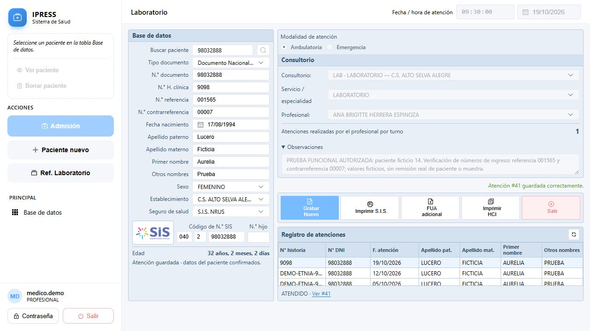

# Prueba de referencia de laboratorio — 19/10/2026

URL probada: http://localhost:8000/laboratorio?paciente_id=14

## Resultado

El módulo permite registrar una atención de laboratorio y guardar números externos de referencia y contrarreferencia de ingreso. No implementa por sí solo el circuito completo de referencia y devolución de resultados.

## Evidencia ejecutada

- Inicio de sesión con las cuentas locales documentadas. ADMIN no puede registrar ni consultar atenciones: es la política explícita del proyecto. PROFESIONAL puede operar la pantalla.
- Paciente 14 identificado en pantalla como ficticio. Se creó la atención **41**, el 19/10/2026 a las 09:30, modalidad AMBULATORIA, en LABORATORIO del C.S. Alto Selva Alegre.
- Referencia de ingreso **001565** y contrarreferencia de ingreso **00007**. La observación identifica expresamente la operación y los números como prueba funcional ficticia.
- Guardado exitoso, actualización del historial y contador del turno de 0 a 1.
- Consulta independiente de solo lectura en MySQL: ambos números conservan sus ceros; estado ATENDIDO; `fua_impresion.referencia_hoja` es NULL; cero documentos de referencia emitidos para la atención 41.
- Se abrió el detalle de la atención desde el historial y la vista de impresión SIS. No se imprimió ni transmitió información al SIS/MINSA.
- Existe un diálogo separado «Crear referencia» en el detalle, con tipo, destino, motivo y observaciones. Se inspeccionó sin emitir otro documento.
- Pruebas existentes: 8 de backend y 10 de frontend aprobadas. El primer intento de frontend falló por el directorio temporal del entorno; al ejecutar con TEMP/TMP del workspace pasó completo.

## Vacíos encontrados

1. **Significado de los campos:** la pantalla no explica que son números de documentos recibidos. La migración y el guardado los definen como identificadores externos de ingreso; no generan correlativos ni emiten documentos.
2. **Vinculación y seguimiento:** los campos son texto opcional de hasta 50 caracteres; no enlazan con una referencia original ni validan su establecimiento de origen, año, estado o relación con la contrarreferencia.
3. **FUA:** esta prueba queda AMBULATORIA y el número de hoja de referencia del FUA queda vacío. Los dos campos de laboratorio no alimentan el circuito REFERENCIA ya existente en admisión. Se necesita definir cuándo corresponde ese circuito y capturar sus datos completos; no basta copiar un número sin origen.
4. **Consulta posterior:** el historial y el detalle general no muestran los dos números como campos propios. La utilidad HCI sí los incluye y su prueba pasó, pero no se ejecutó una impresión física.
5. **Circuito de laboratorio:** esta pantalla no registra examen solicitado, identificación y remisión de la muestra, recepción, resultado validado o devolución al establecimiento solicitante.
6. **Contrarreferencia emitida:** escribir su número no crea un documento de retorno ni vincula resultados con la referencia original. El backend de documentos expone creación de referencias, pero no se encontró un flujo específico de contrarreferencia de resultados.

## Recomendación

Separar explícitamente «recibir una referencia» de «emitir una referencia/contrarreferencia». Primero aclarar los campos de ingreso y mostrarlos en consulta; después conectar origen, destino, solicitud/muestra y resultado con el documento original. Mantener separados los identificadores externos recibidos y la numeración de documentos emitidos por el sistema.

No se modificó código funcional ni se emitió una referencia real. La atención ficticia 41 queda guardada como evidencia de la prueba solicitada.

